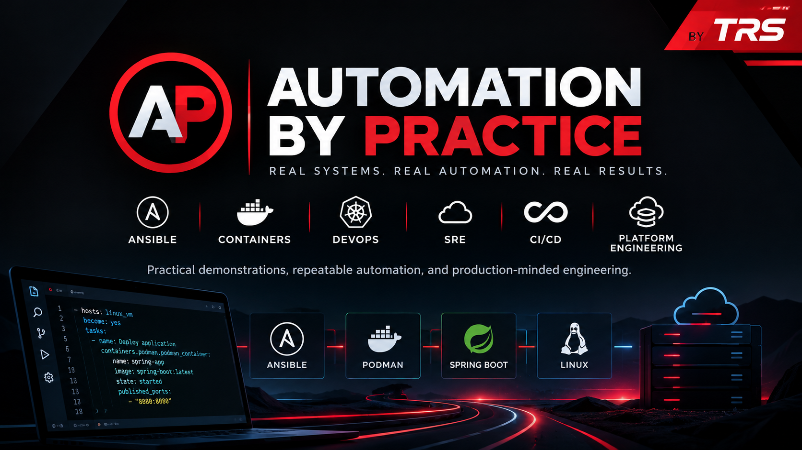

Automation by Practice is where infrastructure automation meets real-world engineering.

Explore hands-on demonstrations covering Ansible, DevOps, SRE, containers, CI/CD, DevSecOps, and platform engineering.

From automating infrastructure and deploying applications to building developer self-service workflows, every episode focuses on practical implementation, repeatable solutions, and lessons learned along the way.

Topics include:

- Ansible automation and best practices
- Podman, containers, and application deployment
- CI/CD and DevSecOps workflows
- Site Reliability Engineering and observability
- Platform engineering and developer golden paths

Less theory. More implementation. Real engineering, demonstrated.

Automation by Practice — by TRS.
