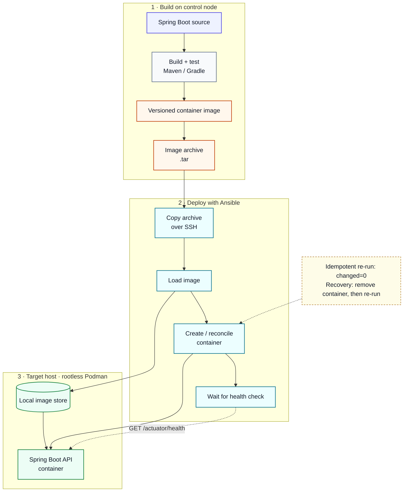

# Build and Deployment Diagram — TRS Episode 01

The flow is grouped into three compact stages for easier screen-share viewing.

See [architecture.md](architecture.md) for the workflow and security principles.
